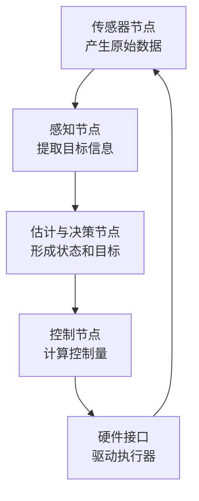
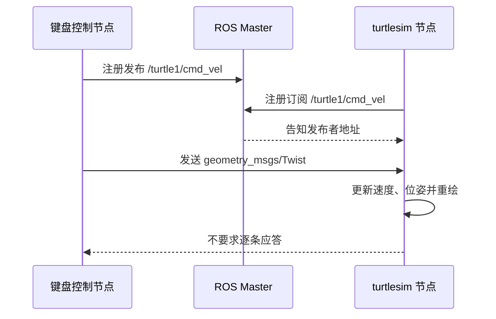
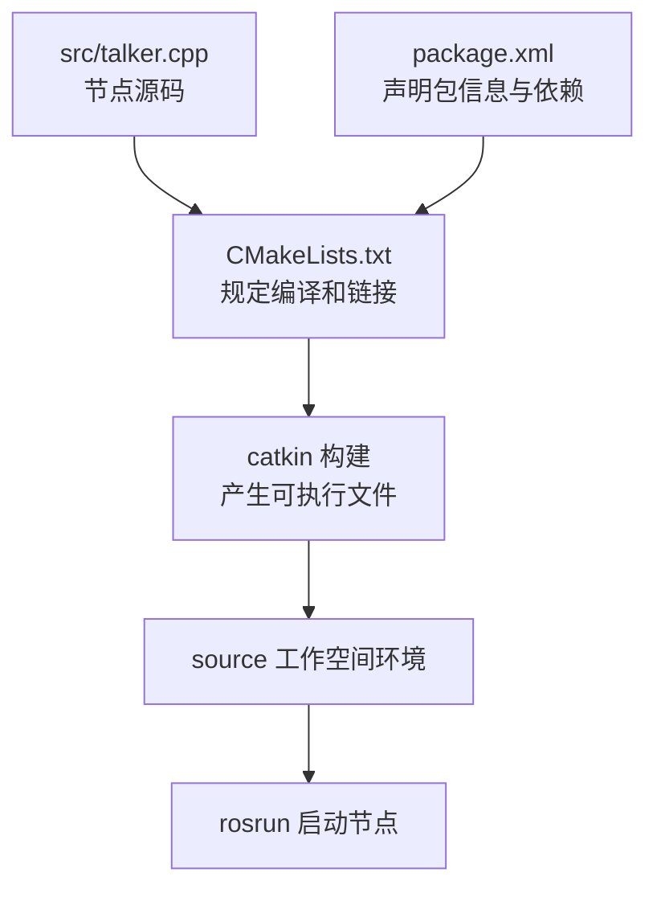
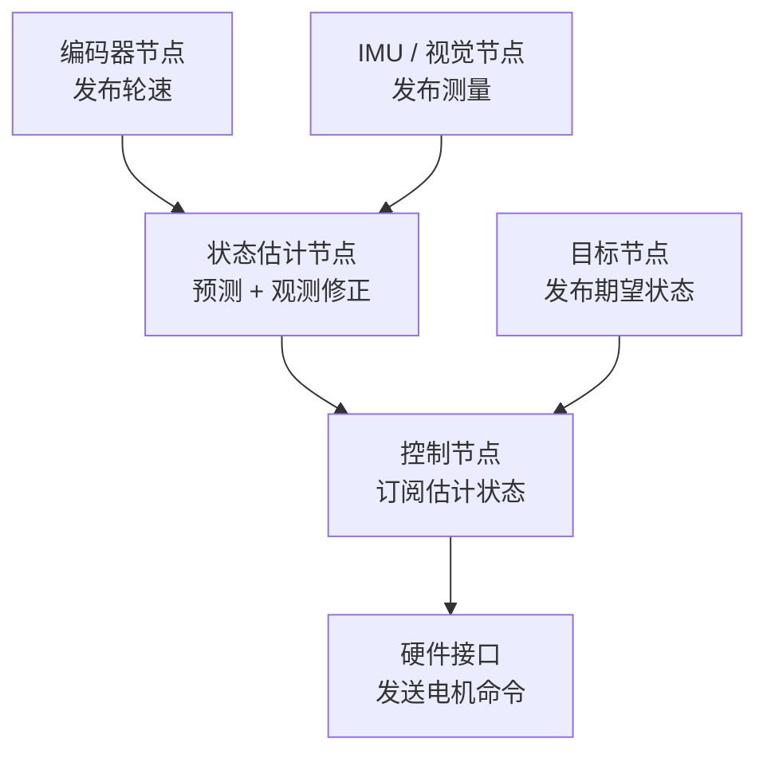

# 第三课：ROS 架构与通信学习笔记

> 课程主题：ROS 1（Noetic）的基本架构、节点与三种通信方式。  
> 学习目标：不只记住命令，而是能沿着数据流解释“谁产生数据、数据走哪个通道、谁处理数据、结果为什么会发生”。  
> 说明：小乌龟、节点、话题、服务和参数是课堂主线；线性代数、卡尔曼滤波与 `ros_control` 放在“从课堂到比赛系统”中作为延伸，不把课外内容冒充课堂实验。

## 阅读路线

这篇笔记按“先建立整体认识，再拆通信机制，最后连接工程应用”的顺序组织：

1. **先看系统**：ROS 为什么存在，节点之间怎样组成计算图；
2. **再看完整例子**：从按下方向键到小乌龟运动，中间发生了什么；
3. **拆开三种通信**：Topic、Service、Parameter 分别解决什么问题；
4. **落到代码与工程**：一个 C++ 程序怎样成为可运行的 ROS 节点；
5. **连接比赛系统**：状态向量、卡尔曼滤波和真实机器人控制怎样接入 ROS 数据流；
6. **形成排错习惯**：按照“节点—连接—类型—数据”逐层定位问题。

---

## 模块一：先从整体上理解 ROS

### 1. ROS 解决的不是“写一个程序”，而是“让很多程序协作”

一台机器人通常同时运行相机驱动、目标识别、状态估计、决策、底盘控制和电机通信等程序。如果这些程序两两直接耦合，那么更换相机、修改控制器或增加一个调试工具，都可能牵连整个系统。

ROS 提供统一的**命名、发现、通信和工具体系**。每个程序只需要说明自己发布什么、订阅什么或提供什么服务，不必知道对方的内部实现。我的理解是：ROS 最重要的价值不是某一条命令，而是把机器人软件拆成边界清楚、可以替换和调试的模块。



### 2. 六个最容易混淆的概念

| 概念 | 它是什么 | 课堂中的例子 | 需要记住的重点 |
| --- | --- | --- | --- |
| Package（包） | 组织源码、配置和依赖的工程单位 | `turtlesim` | 一个包里可以有多个可执行程序 |
| Executable（可执行文件） | 编译后真正被系统启动的程序 | `turtlesim_node` | 它的名字不一定等于节点名 |
| Node（节点） | 一个加入 ROS 计算图的运行中进程 | `/turtlesim` | 节点名是它在 ROS 图中的身份 |
| Topic（话题） | 持续传输消息的数据通道 | `/turtle1/cmd_vel` | 发布者和订阅者通过名字与类型匹配 |
| Message（消息） | 话题中每一份数据的结构 | `geometry_msgs/Twist` | 类型相同才知道各字段怎样解释 |
| Service（服务） | 一次请求对应一次响应 | `/spawn` | 适合需要明确结果的一次性操作 |

Parameter（参数）也属于 ROS 的基础设施，但它主要保存配置，不负责传输连续数据。

以命令 `rosrun turtlesim turtlesim_node` 为例：

- 第一个 `turtlesim` 是包名；
- 第二个 `turtlesim_node` 是包中的可执行文件名；
- 程序运行后默认注册成节点 `/turtlesim`。

### 3. `roscore` 和 Master 到底做什么

运行：

```bash
roscore
```

会启动 ROS Master、参数服务器以及日志相关组件。节点启动后先向 Master 注册自己的名字、话题、服务和通信地址。订阅者通过 Master 找到发布者后，双方再建立点对点连接，大部分话题数据并不由 Master 逐条转发。

因此可以把 Master 理解为“登记处和介绍人”，而不是“所有消息必经的中转站”。这也解释了两个现象：

- 没有 `roscore` 时，新节点通常无法正常注册和互相发现；
- 节点建立联系后，真正的数据传输主要发生在节点之间。

---

## 模块二：用小乌龟走通一条完整数据链

### 1. 三个终端分别承担什么角色

终端 1：启动 ROS 核心。

```bash
roscore
```

终端 2：启动仿真节点。

```bash
rosrun turtlesim turtlesim_node
```

终端 3：启动键盘控制节点。

```bash
rosrun turtlesim turtle_teleop_key
```

要把输入焦点放在终端 3，再按方向键。否则按键不会被 `turtle_teleop_key` 读取。三个终端不是重复操作，而是分别运行 Master、被控制对象和控制命令的产生者。

### 2. “按键以后小乌龟动起来”的内部过程



完整逻辑是：

1. `turtle_teleop_key` 读取方向键；
2. 它把运动意图写进 `geometry_msgs/Twist`；
3. 消息发布到 `/turtle1/cmd_vel`；
4. `/turtlesim` 节点收到消息后执行回调；
5. 更新循环根据速度和时间间隔计算新位置与朝向；
6. 界面重绘，同时发布 `/turtle1/pose`。

方向键并没有直接操作屏幕上的图形。它只是产生一条速度消息，真正改变小乌龟状态的是 `turtlesim` 节点。

### 3. `Twist` 中哪些字段真正影响 turtlesim

先查看消息结构：

```bash
rosmsg show geometry_msgs/Twist
```

`Twist` 包含两个三维向量：

```text
geometry_msgs/Vector3 linear
geometry_msgs/Vector3 angular
```

但“消息里存在某个字段”不等于“接收者一定使用它”。查看 turtlesim 的 Noetic 源码可知，它的速度回调读取的是：

- `linear.x`：沿乌龟当前朝向前进或后退；
- `angular.z`：在二维平面内转向。

`linear.y` 虽然属于 `Twist` 的结构，却不参与 turtlesim 的这段运动处理。这提醒我：理解消息时要同时看**消息定义**和**订阅端怎样使用字段**。

官方实现还会在一段时间没有收到新速度命令后把速度清零。因此松开按键后，小乌龟不会无限保持上一次速度。

### 4. 用 ROS 工具观察这条链路

```bash
rosnode list
rostopic list
rosnode info /turtlesim
rostopic info /turtle1/cmd_vel
rostopic type /turtle1/cmd_vel
rostopic echo /turtle1/pose
rqt_graph
```

这些命令从不同角度回答问题：

| 想知道什么 | 使用的命令 |
| --- | --- |
| 哪些节点正在运行 | `rosnode list` |
| 某个节点连接了哪些话题和服务 | `rosnode info /turtlesim` |
| 系统中有哪些话题 | `rostopic list` |
| 话题两端是谁、类型是什么 | `rostopic info /turtle1/cmd_vel` |
| 话题的消息类型 | `rostopic type /turtle1/cmd_vel` |
| 位姿数据是否真的在更新 | `rostopic echo /turtle1/pose` |
| 用图观察节点连接关系 | `rqt_graph` |

### 5. 节点的名字与结束方式

```bash
rosnode ping /turtlesim
rosnode kill /turtlesim
```

- `rosnode ping` 用于检查节点能否响应；
- `rosnode kill` 通过 ROS 的节点接口请求指定节点关闭；
- 在终端按 `Ctrl+C`，系统向当前前台进程发送中断信号；
- `turtle_teleop_key` 中的 `q` 是程序自己定义的退出按键。

课堂终端里出现的 `^C` 表示收到了 `Ctrl+C`，不是发给小乌龟的控制消息。对 roscpp 节点而言，正常关闭后 `ros::ok()` 会变为 `false`，`ros::spin()` 也会结束，程序便有机会完成清理。

---

## 模块三：三种通信机制应该怎样选择

### 1. Topic：持续的数据流

Topic 适合速度、图像、雷达、位姿等持续产生的数据。它是异步的：发布者发出消息后，不会等待每个订阅者逐条回答。

发布者和订阅者能正确连接，至少需要：

1. 话题名一致；
2. 消息类型一致；
3. 节点已经成功向同一个 Master 注册；
4. 网络配置允许双方访问彼此公布的地址。

#### 发布者：每秒发布一次 `hello`

```cpp
#include <ros/ros.h>
#include <std_msgs/String.h>

int main(int argc, char** argv) {
  ros::init(argc, argv, "talker");
  ros::NodeHandle nh;

  ros::Publisher publisher =
      nh.advertise<std_msgs::String>("/chatter", 10);
  ros::Rate rate(1);

  while (ros::ok()) {
    std_msgs::String message;
    message.data = "hello";
    publisher.publish(message);
    ROS_INFO("publish: %s", message.data.c_str());
    rate.sleep();
  }
  return 0;
}
```

关键语句的作用：

- `ros::init`：初始化 ROS，默认节点名为 `talker`；
- `ros::NodeHandle`：创建发布者、订阅者和服务等对象的入口；
- `advertise<std_msgs::String>`：声明话题和消息类型；
- `10`：发送队列长度，不是频率；
- `ros::Rate(1)`：控制循环约为 1 Hz；
- `publish`：把构造好的消息交给 ROS 发送。

#### 订阅者：收到 `hello` 后打印

```cpp
#include <ros/ros.h>
#include <std_msgs/String.h>

void callback(const std_msgs::String::ConstPtr& message) {
  ROS_INFO("I heard: %s", message->data.c_str());
}

int main(int argc, char** argv) {
  ros::init(argc, argv, "listener");
  ros::NodeHandle nh;

  ros::Subscriber subscriber =
      nh.subscribe("/chatter", 10, callback);
  ros::spin();
  return 0;
}
```

- `subscribe` 把话题、队列长度和回调函数关联起来；
- 消息到达后，ROS 调用 `callback`；
- `ros::spin()` 让程序持续处理回调；如果删掉它，`main` 很快结束，节点也就退出；
- 回调函数应尽量短。长时间阻塞会使后续消息排队，队列满时可能丢消息。

这里“发布者注册、订阅端注册、两边话题一致”并不表示两个节点直接写死了对方地址。它们先各自向 Master 报告，再由 ROS 完成发现和连接。

#### 不写代码也能发布速度

```bash
rostopic pub -r 10 /turtle1/cmd_vel geometry_msgs/Twist "linear:
  x: 2.0
  y: 0.0
  z: 0.0
angular:
  x: 0.0
  y: 0.0
  z: 1.0"
```

这条命令表示以 10 Hz 向 `/turtle1/cmd_vel` 重复发布 `geometry_msgs/Twist`。`linear.x = 2.0` 让乌龟向前，`angular.z = 1.0` 让它同时转向，所以轨迹接近圆形。

课堂中出现过：

```text
ERROR: invalid topic type: 10
```

这不是“频率 10 不合法”，而是命令位置写错，导致 `rostopic` 把 `10` 当成了消息类型。正确顺序是：

```text
rostopic pub [选项] 话题名 消息类型 消息内容
```

可以先查清类型，再重新输入完整命令：

```bash
rostopic type /turtle1/cmd_vel
rosmsg show geometry_msgs/Twist
```

### 2. Service：一次请求，一次回答

Service 适合“做一次并告诉我结果”的操作，例如生成乌龟、清空轨迹或查询状态。调用者会等待这一轮响应，因此不适合代替高频图像或速度流。

```bash
rosservice list
rosservice type /spawn
rossrv show turtlesim/Spawn
```

生成一只名为 `turtle2` 的乌龟：

```bash
rosservice call /spawn "x: 2.0
y: 3.0
theta: 0.0
name: 'turtle2'"
```

其中 `x`、`y`、`theta` 和 `name` 是请求字段，响应中的 `name` 是最终创建的名称。使用服务前先看 `.srv` 结构，比照着截图猜参数更可靠。

### 3. Parameter：运行时配置

Parameter 适合背景颜色、阈值、增益等配置。它不是连续数据总线，也不适合高速更新。

```bash
rosparam list
rosparam get /turtlesim/background_r
rosparam set /turtlesim/background_r 255
rosparam set /turtlesim/background_g 255
rosparam set /turtlesim/background_b 255
rosservice call /clear
```

前三条 `set` 修改背景参数，调用 `/clear` 后 turtlesim 重新刷新背景。参数较多时通常写入 YAML，再由 launch 文件统一加载，便于复现实验配置。

### 4. 一张表判断该用哪一种

| 需求 | 应优先选择 | 原因 |
| --- | --- | --- |
| 相机不断输出图像 | Topic | 连续、一对多、无需逐帧应答 |
| 持续发送底盘目标速度 | Topic | 控制目标会反复更新 |
| 请求生成一只新乌龟 | Service | 一次请求，需要知道是否成功 |
| 设置检测阈值或控制增益 | Parameter | 属于运行配置，不是数据流 |
| 要求长时间执行、可反馈进度和取消 | Action | Topic 与 Service 之外的进阶机制，本课先知道用途 |

---

## 模块四：一个 C++ 文件怎样变成 ROS 节点

这一模块把第二课的 CMake/Catkin 与第三课串起来。源代码不会因为包含了 `ros/ros.h` 就自动变成可运行节点，还需要软件包描述、依赖声明、编译链接和工作空间环境。

### 1. 从源码到运行的完整关系



### 2. 软件包中的关键文件

```text
dx_ros_practice/
├── CMakeLists.txt
├── package.xml
└── src/
    ├── talker.cpp
    └── listener.cpp
```

- `package.xml`：描述包名、版本、维护者和依赖；
- `CMakeLists.txt`：告诉构建系统找哪些包、编译哪些源码、链接哪些库；
- `src/*.cpp`：节点的 C++ 源码。

对应的核心 CMake 写法是：

```cmake
find_package(catkin REQUIRED COMPONENTS
  roscpp
  std_msgs
)

catkin_package()

include_directories(
  ${catkin_INCLUDE_DIRS}
)

add_executable(talker src/talker.cpp)
target_link_libraries(talker ${catkin_LIBRARIES})

add_executable(listener src/listener.cpp)
target_link_libraries(listener ${catkin_LIBRARIES})
```

`add_executable` 负责把 `.cpp` 编译成可执行程序，`target_link_libraries` 负责链接 ROS 库。只有源码而没有这两步，`rosrun` 找不到可执行目标。

### 3. 一套可复现的构建流程

以下命令是复习模板；完成时应记录自己的真实输出，不把“准备运行”写成“已经成功”。

```bash
mkdir -p ~/catkin_ws/src
cd ~/catkin_ws/src
catkin_create_pkg dx_ros_practice roscpp std_msgs geometry_msgs
cd ~/catkin_ws
catkin build
source devel/setup.bash
```

将源码与 CMake 配好后，再执行：

```bash
cd ~/catkin_ws
catkin build dx_ros_practice
source devel/setup.bash
rosrun dx_ros_practice talker
```

另开终端运行订阅者时，也要加载同一工作空间：

```bash
source ~/catkin_ws/devel/setup.bash
rosrun dx_ros_practice listener
```

如果自己的环境采用 `catkin_make`，就在工作空间根目录使用 `catkin_make`。同一工作空间不要随意混用 `catkin_make` 与 `catkin build`，因为两者的构建目录布局和管理方式不同。

### 4. 节点运行后，重点观察什么

```bash
rosnode list
rostopic info /chatter
rostopic echo /chatter
rostopic hz /chatter
```

预期关系应为：

- `/talker` 发布 `/chatter`；
- `/listener` 订阅 `/chatter`；
- `/chatter` 的类型为 `std_msgs/String`；
- 发布频率约为 1 Hz；
- 订阅端打印 `I heard: hello`。

这几项是“通信确实成立”的证据，比只看到程序没有报错更可靠。

---

## 模块五：从课堂例子连接到 RoboMaster 系统

> 本模块用于建立后续课程的接口。它解释课堂知识将来用在哪里，不表示本节课已经实现了完整状态估计或底盘控制。

### 1. 小乌龟和真实机器人的对应关系

| 小乌龟例子 | 真实机器人中可能对应 |
| --- | --- |
| 键盘节点发布速度 | 决策或遥控节点给出目标速度 |
| `/turtle1/cmd_vel` | 底盘速度目标话题 |
| turtlesim 接收并更新状态 | 控制器接收目标并计算电机指令 |
| `/turtle1/pose` | 定位或状态估计节点发布的位姿 |
| 屏幕上的轨迹 | 机器人真实运动及传感器反馈 |

差别在于：仿真只需更新数学状态和画面，真实机器人还要处理编码器、IMU、CAN 总线、控制周期、延迟和噪声。

### 2. 为什么线性代数会出现在 ROS 数据流里

线性代数视频最值得带回 ROS 的不是背矩阵运算，而是两个观念：

1. **向量表示一个完整状态**。例如二维机器人可以用

   $$
   \mathbf{x} = [x,\ y,\ \theta,\ v,\ \omega]^T
   $$

   同时描述位置、朝向、线速度和角速度。

2. **矩阵表示一种线性变换或状态关系**。坐标系变换、相机投影、状态预测都会把一个向量映射到另一个向量。

在 ROS 中，消息负责把这些数值从一个节点送到另一个节点；线性代数负责说明这些数值怎样组合和变换。ROS 解决“数据怎么到达”，算法解决“数据到达后怎么算”。

### 3. 卡尔曼滤波为什么适合做成一个节点

传感器有噪声，只依靠运动模型又会逐渐漂移。卡尔曼滤波把两类信息结合起来：

- **预测**：根据上一时刻状态和控制输入推测现在的位置；
- **观测**：读取相机、编码器或 IMU 给出的测量；
- **修正**：依据两边的不确定性决定更信任谁。

最基本的线性形式可以先读懂含义，不必现在推导全部协方差公式：

$$
\hat{\mathbf{x}}_k^- = A\hat{\mathbf{x}}_{k-1} + B\mathbf{u}_k
$$

$$
\hat{\mathbf{x}}_k = \hat{\mathbf{x}}_k^- + K_k(\mathbf{z}_k - H\hat{\mathbf{x}}_k^-)
$$

- `上一状态 + 控制输入` 得到预测值 $\hat{\mathbf{x}}_k^-$；
- $\mathbf{z}_k - H\hat{\mathbf{x}}_k^-$ 是“实测与预测的差”；
- $K_k$ 决定这次修正的幅度，它与模型和测量的不确定性有关。

所以卡尔曼滤波不只是“把曲线变平滑”，而是在模型预测与传感器观测之间进行带有不确定性权衡的融合。

放进 ROS 后，可以形成这样的模块关系：



这正体现了 ROS 的模块化：更换某种传感器时，只要消息接口保持一致，估计与控制节点不必全部重写。

### 4. `ros_control` 的 `read-update-write` 循环

对真实底盘，可以把一轮控制记成三步：

1. `read`：从编码器、IMU 或电机驱动读取当前状态；
2. `update`：控制器根据目标值与当前状态计算输出；
3. `write`：通过 CAN、EtherCAT 等接口把命令发给执行器。

ROS 话题主要传递模块之间的目标和状态；控制算法计算控制量；硬件接口负责把统一的软件接口翻译成具体总线数据。三者不能混为一层。

---

## 模块六：排错、复现与自测

### 1. “节点在运行但没有反应”时的固定排错顺序

| 层级 | 要回答的问题 | 建议命令 |
| --- | --- | --- |
| 1. Master | ROS 核心是否正常 | `rosnode list` |
| 2. Node | 需要的节点是否存在、能否响应 | `rosnode list`、`rosnode ping /turtlesim` |
| 3. Connection | 发布者和订阅者是否连接 | `rosnode info /turtlesim`、`rqt_graph` |
| 4. Name | 话题名是否完全一致 | `rostopic list`、`rostopic info /turtle1/cmd_vel` |
| 5. Type | 消息类型和字段是否正确 | `rostopic type ...`、`rosmsg show ...` |
| 6. Data | 是否真的有数据，频率是否合理 | `rostopic echo ...`、`rostopic hz ...` |
| 7. Service | 请求类型和字段是否正确 | `rosservice type ...`、`rossrv show ...` |
| 8. Build | 包是否编译并加载环境 | `catkin build`、`source devel/setup.bash` |

我应该沿着数据流逐层缩小范围，而不是一看到没反应就反复重启。比如“乌龟不动”可以依次判断：控制节点是否存在 → `/cmd_vel` 是否存在 → 类型是不是 `Twist` → `echo` 能否看到数据 → `turtlesim` 是否订阅成功。

### 2. 常见现象与原因

| 现象 | 优先检查 |
| --- | --- |
| `rosrun` 找不到包 | 当前终端是否 `source` 了正确工作空间 |
| `rosrun` 找到包但找不到节点 | `CMakeLists.txt` 是否生成可执行文件，构建是否成功 |
| 发布端有输出，订阅端无输出 | 话题名、消息类型和 ROS Master 是否一致 |
| `invalid topic type: 10` | `-r 10` 的位置以及真正的消息类型 |
| 小乌龟窗口存在但方向键无效 | 键盘焦点是否在 teleop 终端 |
| `echo` 有消息但对象不运动 | 接收节点是否订阅、实际使用了哪些消息字段 |
| 新终端执行命令找不到自建包 | 新终端还没有加载 `devel/setup.bash` |

### 补充：10月29日实操注意事项（Docker + ROS）

- **分清宿主机和容器**：在 Ubuntu 宿主机用 `sudo docker ps -a` 查看真实容器名，再用 `sudo docker exec -it noetic-gui bash` 进入；出现 `root@...#` 后已在容器内，不要再次执行 `docker exec`。
- **ROS 环境只在对应环境内加载**：宿主机找不到 `/opt/ros/noetic/setup.bash` 不等于 ROS 没装；容器内 `echo $ROS_DISTRO` 已确认 `noetic`。现有工作目录是 `/workspace/ros1_ws`，复用旧工程前先检查是否需要 `source devel/setup.bash`。
- **不要重复启动 Master**：`roscore` 提示 `another roscore/master is already running` 时，先用 `rosnode list`、`rostopic list` 验证现有服务，不要随意杀进程。今天已查询到 `/dx_velocity_node` 与 `/dx_demo/cmd_vel`，具体发布者、消息类型和数据仍须用 `rosnode info`、`rostopic info/type/echo` 验证。
- **图形故障≠ROS故障**：`turtlesim` 出现 `Authorization required`、`could not connect to display :0` / Qt `xcb` 错误，应先排查宿主机 X11 授权、`DISPLAY` 和 `/tmp/.X11-unix` 挂载；不要直接重装 ROS。**本次小乌龟图形显示尚未验证修复。**
- **安装包提示需分辨严重程度**：Clash Verge 的 `正在设置` 表示安装成功；APT 访问本地 `.deb` 的低权限警告不等于失败。暂不盲目执行 `apt autoremove`，以免误删 Fcitx 输入法依赖。

### 3. 课后复现清单

下面使用未勾选框，是为了区分“笔记中已经理解”与“我在本机重新完成并保存证据”。每完成一项，再把 `[ ]` 改成 `[x]` 并补一句结果。

- [ ] 用三个终端启动 `roscore`、`turtlesim_node` 和 `turtle_teleop_key`；
- [ ] 用 `rqt_graph` 看见键盘节点到 `/turtlesim` 的话题连接；
- [ ] 用 `rostopic echo /turtle1/pose` 观察位置和角度变化；
- [ ] 不用键盘，使用 `rostopic pub -r 10` 让乌龟走圆；
- [ ] 用 `/spawn` 创建 `turtle2`，并解释请求与响应字段；
- [ ] 修改背景参数并调用 `/clear` 刷新；
- [ ] 编译 `talker` 和 `listener`，验证 `/chatter` 为 1 Hz；
- [ ] 故意写错一次话题名或类型，再用固定排错顺序找出问题。

### 4. 不看答案先自测

1. 为什么方向键不是直接控制小乌龟？
2. `/turtle1/cmd_vel` 和 `geometry_msgs/Twist` 分别是什么？
3. `Twist` 中存在 `linear.y`，为什么 turtlesim 不一定使用它？
4. Master 完成连接后，话题数据是否仍要逐条经过 Master？
5. `ros::spin()` 为什么不能从订阅者中随便删掉？
6. Topic、Service、Parameter 分别适合什么场景？
7. `Ctrl+C`、`q` 和 `rosnode kill` 有什么区别？
8. 为什么看到程序没有报错，还不能证明通信成功？
9. 卡尔曼滤波节点的输入和输出可以分别是什么？
10. 真实机器人的 `read-update-write` 各负责什么？

<details>
<summary>展开核对答案</summary>

1. 键盘节点只负责把运动意图编码成消息，真正更新状态的是订阅该消息的 turtlesim 节点。
2. 前者是话题名，后者是消息类型。
3. 消息定义只规定可用字段；接收端源码决定实际读取哪些字段，turtlesim 主要读取 `linear.x` 和 `angular.z`。
4. 通常不需要。Master 负责注册与发现，数据主要由节点之间直接传输。
5. 没有持续处理回调的循环，`main` 会结束，订阅节点也随之退出。
6. 连续数据用 Topic；一次请求和响应使用 Service；运行配置使用 Parameter。
7. `Ctrl+C` 中断当前前台进程；`q` 是 teleop 程序定义的退出键；`rosnode kill` 从另一个终端请求指定节点关闭。
8. 还需要核对节点、连接、类型、真实数据和频率。
9. 输入可以是运动模型、控制量和传感器测量，输出是融合后的状态估计及其不确定性。
10. `read` 读取硬件状态，`update` 计算控制量，`write` 把命令发送给硬件。

</details>

## 本节总结

我对第三课主线的理解可以压缩成一句话：**ROS 把机器人拆成多个节点，再用有明确名字和类型的接口把它们连接起来。**

小乌龟例子让我看到一条最小但完整的链路：输入节点发布 `Twist`，仿真节点订阅并处理，位姿再作为状态发布。Topic、Service 和 Parameter 的区别，本质上是连续数据、一次交互和运行配置三类需求的区别。以后接触视觉、卡尔曼滤波和底盘控制时，算法内容会变复杂，但仍然可以用同样的问题去分析：数据从哪里来、是什么类型、经过哪个节点、最后驱动什么结果。

## 参考资料

- [第三课课堂录屏：ROS 架构与通信](https://www.bilibili.com/video/BV1cgxM6fEya/)
- [线性代数的本质系列](https://www.bilibili.com/video/BV1ys411472E/)
- [卡尔曼滤波保姆级动画拆解](https://www.bilibili.com/video/BV1Cvpi6eE9q/)
- [ROS Noetic 官方 talker 示例](https://github.com/ros/ros_tutorials/blob/noetic-devel/roscpp_tutorials/talker/talker.cpp)
- [ROS Noetic 官方 listener 示例](https://github.com/ros/ros_tutorials/blob/noetic-devel/roscpp_tutorials/listener/listener.cpp)
- [turtlesim 官方运动处理源码](https://github.com/ros/ros_tutorials/blob/noetic-devel/turtlesim/src/turtle.cpp)
- [ROS Wiki：Understanding ROS Nodes](https://wiki.ros.org/ROS/Tutorials/UnderstandingNodes)
- [ROS Wiki：Understanding ROS Topics](https://wiki.ros.org/ROS/Tutorials/UnderstandingTopics)
- [ROS Wiki：Understanding ROS Services and Parameters](https://wiki.ros.org/ROS/Tutorials/UnderstandingServicesParams)
- [ros_control 的 RobotHW 接口](https://github.com/ros-controls/ros_control/blob/noetic-devel/hardware_interface/include/hardware_interface/robot_hw.h)
