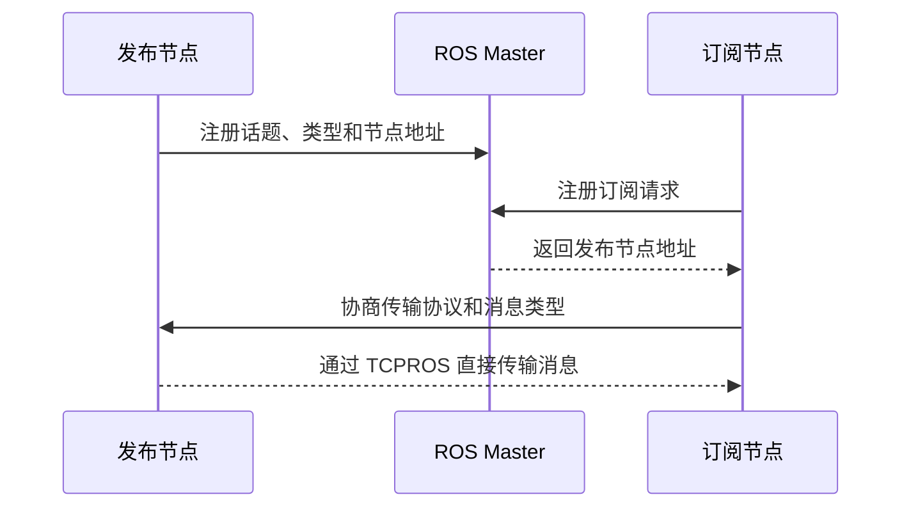
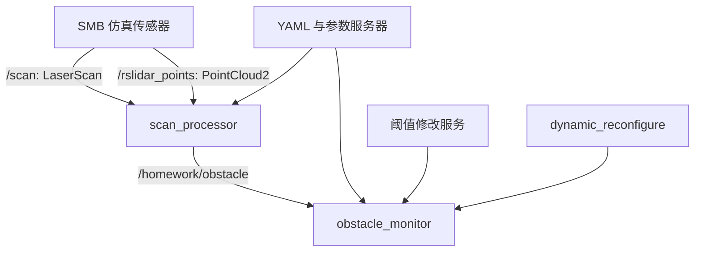

# ROS 架构与通信学习笔记

> 课程：DynamicX 控制视觉培训课（ROS 第一课）<br>
> 环境：ROS 1 Noetic、Ubuntu 20.04、C++（`roscpp`）<br>
> 本文重点：先建立 ROS 的整体模型，再梳理包、节点和三种通信方式，最后整理 `ros_control` 与后续作业的准备方向。

## 1. 我对 ROS 的整体理解

ROS 全称 Robot Operating System，但它并不是 Windows 或 Linux 这种直接管理硬件和进程的操作系统。更准确地说，它是一套运行在 Linux 上的机器人软件框架，主要提供三方面能力：

1. **通信中间件**：让不同进程通过话题、服务和参数交换信息。
2. **开发与调试工具**：包括 catkin、launch、RViz、rqt、rosbag 等。
3. **软件包生态**：相机、雷达、IMU、导航、机械臂等功能都有可复用的软件包。

课堂前我把 ROS 理解成“许多机器人库的集合”。学完之后，我觉得这个说法不够完整。库解决的是“函数怎么调用”，ROS 更重要的作用是规定“多个独立程序如何组织、发现彼此并交换数据”。

在机器人上，一条典型的数据链可以写成：


这条链里，每个框通常是一个节点，箭头大多是话题。节点只需要遵守接口，不必知道其他节点内部如何实现，因此队员可以并行开发。

> 版本说明：课程使用的 ROS 1 Noetic 已于 2025 年 5 月 31 日结束官方维护。为了完成现有机器人项目和课程实验，继续学习 ROS 1 仍然有价值；如果从零开始长期维护新项目，还需要了解 ROS 2 的迁移方向。

## 2. ROS 的三层架构

我把 ROS 分成文件系统层、计算图层和通信层。这样分类最大的好处是遇到问题时能先判断问题在哪一层，而不是一上来就反复编译。

| 层次 | 主要问题 | 关键对象 | 常见故障 |
| --- | --- | --- | --- |
| 文件系统层 | 代码和依赖如何组织 | workspace、package、`package.xml`、`CMakeLists.txt`、`launch`、`config` | 找不到包、缺依赖、编译失败 |
| 计算图层 | 正在运行的程序如何协作 | node、topic、message、service、parameter | 名字或类型不一致、节点未启动 |
| 通信层 | 数据如何在进程之间传输 | XML-RPC、TCPROS、UDPROS、序列化、队列 | 网络不可达、延迟、积压、丢消息 |

我的排错顺序是：

1. 节点是否真的启动，终端第一条报错是什么。
2. 节点名、话题名和消息类型是否一致。
3. 发布者和订阅者是否已经建立连接。
4. 最后再看频率、队列、带宽和回调耗时。

## 3. ROS Master 与节点发现

### 3.1 Master 的职责

ROS 1 的 Master 主要负责名称注册和查询，也提供参数服务器。它像“通讯录”，并不是消息的中转站。

`roscore` 一般会启动：

- ROS Master；
- 参数服务器；
- 日志聚合节点 `/rosout`。

一次典型的话题连接过程如下：



这里最关键的一点是：**只有发现阶段需要 Master，正常的话题数据不经过 Master。**

### 3.2 两个容易说得过于绝对的地方

- Master 退出后，已经建立的某些点对点连接可能继续传输，但新节点注册、新连接建立、参数访问和断线重连会受影响，所以不能简单理解为“Master 挂了也没事”。
- Master 保存注册信息，但它不是完整的健康监控器。节点异常退出后可能留下过期注册，排查时还要结合 `rosnode ping`、`rosnode cleanup` 和实际连接情况。

## 4. 工作空间和功能包

### 4.1 catkin 工作空间

```text
catkin_ws/
├── src/                 # 源码，应该进入 Git
│   ├── CMakeLists.txt
│   └── my_pkg/
├── build/               # 编译中间文件，不提交
├── devel/               # 开发空间和 setup.bash，不提交
└── logs/                # catkin_tools 日志，不提交
```

常用流程：

```bash
cd ~/catkin_ws
catkin build              # 使用 catkin_tools 时
source devel/setup.bash
```

如果使用系统自带的基础流程，也可能看到 `catkin_make`。两套工具生成目录的方式不同，一个工作空间里不应随意混用。

`source devel/setup.bash` 的作用是把当前工作空间加入环境变量。忘记 source 时，即使编译成功，`rosrun`、`roslaunch` 和 `rospack find` 仍可能找不到自己的包。

### 4.2 一个功能包的基本结构

```text
my_pkg/
├── CMakeLists.txt       # 编译规则
├── package.xml          # 包的身份、版本和依赖
├── include/my_pkg/      # 对外头文件
├── src/                 # C++ 源文件
├── msg/                 # 自定义消息
├── srv/                 # 自定义服务
├── launch/              # 启动编排
├── config/              # YAML 参数
└── README.md            # 构建和运行说明
```

我现在把 `package.xml` 和 `CMakeLists.txt` 的关系理解为：

- `package.xml` 面向包管理系统，声明“我是谁、我依赖谁”；
- `CMakeLists.txt` 面向构建系统，声明“哪些源码生成哪些目标、需要链接哪些库”；
- 同一个依赖通常需要在两个文件里对应出现，否则可能在本机碰巧能编译，换环境就失败。

### 4.3 自定义消息需要完整配置

以 `ObstacleDistance.msg` 为例：

```text
float32 min_distance
bool valid
```

`package.xml` 至少要区分消息生成期和运行期依赖：

```xml
<build_depend>message_generation</build_depend>
<exec_depend>message_runtime</exec_depend>
```

`CMakeLists.txt` 中相关步骤要配套：

```cmake
find_package(catkin REQUIRED COMPONENTS
  roscpp
  std_msgs
  message_generation
)

add_message_files(
  FILES
  ObstacleDistance.msg
)

generate_messages(
  DEPENDENCIES
  std_msgs
)

catkin_package(
  CATKIN_DEPENDS roscpp std_msgs message_runtime
)
```

如果节点包含自动生成的消息头，还需要让可执行目标依赖消息生成目标。否则并行编译时可能先编译 `.cpp`，此时消息头还没有生成。

## 5. 计算图的五个基本对象

| 对象 | 我的理解 | 常用查看命令 |
| --- | --- | --- |
| Node | 一个独立进程，尽量只负责一类任务 | `rosnode list`、`rosnode info` |
| Topic | 异步数据通道，适合连续数据流 | `rostopic list`、`echo`、`info`、`hz` |
| Message | 话题上传输的数据结构，由 `.msg` 定义 | `rosmsg show` |
| Service | 一次请求和一次响应，由 `.srv` 定义 | `rosservice list`、`call`，`rossrv show` |
| Parameter | Master 上的全局键值配置 | `rosparam list`、`get`、`set`、`load` |

节点、话题和消息容易混淆。比如 `/turtle1/cmd_vel` 是话题名，`geometry_msgs/Twist` 是消息类型，发布或订阅它的程序才是节点。

## 6. 三种通信方式

### 6.1 Topic：连续、异步的数据流

话题采用发布/订阅模型。发布者把消息写入某个话题，订阅者在回调函数中接收消息，两边不需要直接认识。

适合的话题包括图像、点云、里程计、目标位置和速度指令。

最小发布端的核心写法：

```cpp
ros::NodeHandle nh;
ros::Publisher pub = nh.advertise<std_msgs::String>("/chatter", 10);

ros::Rate rate(10);
while (ros::ok()) {
  std_msgs::String msg;
  msg.data = "hello";
  pub.publish(msg);
  ros::spinOnce();
  rate.sleep();
}
```

最小订阅端：

```cpp
void callback(const std_msgs::String::ConstPtr& msg) {
  ROS_INFO("I heard: %s", msg->data.c_str());
}

ros::NodeHandle nh;
ros::Subscriber sub = nh.subscribe("/chatter", 10, callback);
ros::spin();
```

我认为话题最值得注意的不是 API，而是以下四点：

1. 话题名相同还不够，消息类型也必须完全一致。
2. `queue_size` 是缓冲深度，不是越大越好。控制数据更关心新鲜度，积压旧指令反而危险。
3. 回调函数执行太久会阻塞同一回调队列中的后续消息。耗时算法应拆节点、使用工作线程或重新设计数据流。
4. 普通话题不会给晚到的订阅者补发历史消息。只有使用 latched publisher 时，新订阅者连接后才会先收到最后一条缓存消息。

### 6.2 Service：需要明确结果的一次调用

服务适合低频、边界清楚、需要返回结果的操作，例如生成模型、切换模式、清空轨迹或修改一次阈值。

一个服务定义用 `---` 分隔请求和响应：

```text
# SetWarningDistance.srv
float32 distance
---
bool success
string message
```

客户端调用通常会等待响应。因此我不会用服务传输高频传感器数据，也不会在控制主循环中无超时地调用可能卡住的服务。默认的非持久服务调用还包含连接开销；即使可以使用持久连接，高频数据流通常仍更适合话题。

### 6.3 Parameter：共享配置，不是实时数据

参数服务器适合相机曝光、PID 系数、报警阈值、话题名等配置。

```cpp
ros::NodeHandle pnh("~");
double warning_distance = 1.0;
pnh.param<double>("warning_distance", warning_distance, 1.0);
```

这里使用私有句柄 `~` 后，参数会放在节点自己的命名空间下，可以避免不同节点使用同名参数时互相覆盖。

需要特别注意：参数服务器中的值改变，不代表节点内部变量一定立即改变。节点如果只在启动时读取一次，后续 `rosparam set` 不会自动修改这个变量。要实现在线更新，需要主动轮询、重新读取，或使用 `dynamic_reconfigure`。

### 6.4 如何选择

| 需求 | 合适机制 | 原因 |
| --- | --- | --- |
| 连续传感器数据或控制指令 | Topic | 异步，支持一对多和多对多 |
| 偶尔执行一次且需要结果 | Service | 请求和响应边界清楚 |
| 启动配置或低频可调参数 | Parameter | 可集中加载和按命名空间管理 |
| 持续一段时间、需要反馈和取消 | Action | 比普通服务更适合长任务 |

## 7. YAML 参数文件

YAML 的核心是用缩进表示层级。我给自己总结了几条硬规则：

- 只用空格缩进，不使用 Tab；
- 同一层严格对齐，建议每层两个空格；
- `:` 后必须留空格；
- 字符串中包含特殊字符或容易产生歧义时加引号；
- 注意类型，`30`、`30.0` 和 `"30"` 分别是整数、浮点数和字符串。

示例：

```yaml
topics:
  laser: "/scan"
  pointcloud: "/rslidar_points"

subscriber:
  queue_size: 10

warning:
  distance: 1.0
  enabled: true
```

三种常见加载方式：

```bash
# 命令行临时加载
rosparam load config/params.yaml /smb_highlevel_controller
```

```xml
<!-- launch 中加载，文件路径可以随软件包迁移 -->
<rosparam
  command="load"
  file="$(find smb_highlevel_controller)/config/params.yaml"
  ns="smb_highlevel_controller" />
```

```cpp
// 代码中读取，始终提供安全默认值
pnh.param<std::string>("topics/laser", laser_topic, "/scan");
```

命名空间是最容易踩的坑。比如 YAML 内已经有 `camera:`，加载时又指定 `/camera`，最后可能得到 `/camera/camera/...`。加载后应立即用 `rosparam get <namespace>` 检查实际参数树和数据类型。

## 8. ros_control 的基本链路

课件把 `ros_control` 作为下节控制作业的重点。它的核心思想是把控制算法与具体硬件访问分开。


一个典型控制周期的顺序是：

```text
read() 读取硬件状态
    ↓
controller_manager.update() 根据状态计算指令
    ↓
write() 把指令发送给硬件
```

我对几个组件的理解：

- **Controller Manager**：加载、启动、停止和切换控制器，并在更新周期中调用控制器。
- **Controller**：实现位置、速度、力矩、轨迹或底盘控制算法。
- **RobotHW / hardware_interface**：把上层的关节状态和命令接口映射到底层总线数据。
- **joint limits / transmission**：描述关节限位以及执行器和关节之间的映射关系。

这种分层带来的直接好处是：换电机或通信总线时，尽量只改硬件接口；换控制算法时，尽量只换控制器；仿真和实车可以共用上层接口。

实际实现时，我会特别检查：

1. `read-update-write` 的周期是否稳定，周期时间是否正确传给控制器。
2. 控制循环内不能做阻塞服务调用、频繁分配内存或大量日志输出。
3. 通信超时后要进入安全状态，不能继续发送最后一次力矩指令。
4. 单位、正方向、关节顺序和限幅要在接口边界处统一。

## 9. 常用命令与排错方法

### 9.1 命令速查

| 场景 | 命令 |
| --- | --- |
| 启动核心 | `roscore` |
| 查看包位置 | `rospack find <pkg>` |
| 启动节点 | `rosrun <pkg> <node>` |
| 启动 launch | `roslaunch <pkg> <file.launch>` |
| 查看节点 | `rosnode list`、`rosnode info <node>`、`rosnode ping <node>` |
| 查看话题 | `rostopic list`、`echo`、`info`、`hz` |
| 查看消息定义 | `rosmsg show <pkg/Type>` |
| 查看或调用服务 | `rosservice list`、`type`、`call` |
| 查看服务定义 | `rossrv show <pkg/Type>` |
| 管理参数 | `rosparam list`、`get`、`set`、`load`、`dump` |
| 查看计算图 | `rqt_graph` |
| 录制与回放 | `rosbag record`、`info`、`play` |

### 9.2 “节点在运行但收不到消息”的排查顺序

```bash
rosnode list
rosnode info /my_node
rostopic list
rostopic info /expected_topic
rostopic echo -n 1 /expected_topic
rostopic hz /expected_topic
```

然后依次回答：

1. 节点真的存在吗，还是启动后马上退出了？
2. 订阅的话题名是否受命名空间或 remap 影响？
3. 发布和订阅的消息类型是否相同？
4. 发布者是否真的在持续发，频率是否合理？
5. 多机通信时，`ROS_MASTER_URI`、主机名解析和防火墙是否正确？
6. 回调是否被长任务阻塞，队列是否持续丢消息？

这个过程比“先清空 build 再重编”更有效，因为很多通信问题和编译无关。

## 10. 小乌龟实验复现清单

我准备按三个终端复现课堂流程：

```bash
# 终端 1
roscore

# 终端 2
rosrun turtlesim turtlesim_node

# 终端 3
rosrun turtlesim turtle_teleop_key
```

验证内容：

- [ ] `rosnode list` 能看到仿真与键盘节点；
- [ ] `rostopic info /turtle1/cmd_vel` 能区分发布者和订阅者；
- [ ] `rostopic echo /turtle1/pose` 能看到位姿变化；
- [ ] `rosservice call /spawn ...` 能生成新乌龟；
- [ ] 修改背景参数后调用 `/clear` 能看到效果；
- [ ] `rqt_graph` 中能解释每一条节点和话题连接。

这里我没有把计划写成已经完成的实验结果。真正运行后还要补充终端截图和异常记录，避免把“会背命令”误当成“能排查系统”。

## 11. 对视觉作业的数据流拆解

视觉作业要求从 SMB 仿真中读取激光与点云，发布最近障碍物距离，再由监控节点报警。我把它拆成下面的数据流：



实现时需要注意：

- LaserScan 的有效距离应满足 `std::isfinite(range)`，并位于 `[range_min, range_max]` 内；不能让 `NaN` 或无穷值参与最小值计算。
- 整帧没有有效测量时，发布 `valid=false` 且 `min_distance=0`，监控节点不报警。
- “小于阈值”才报警，因此距离等于阈值时不报警。
- `PointCloud2` 的点数通常可由 `width * height` 得到，同时要注意有序点云和空点云。
- 服务修改的是运行中的报警距离，`dynamic_reconfigure` 只控制报警开关，两者不要重复管理同一个参数。
- 关闭报警后，节点仍应接收消息并响应服务，只是不输出报警。
- rosbag 记录的是指定话题的消息。只录 `/homework/obstacle` 时，不会自动保存服务调用过程，也不会自动保存参数服务器的变化。
- `pointcloud_to_laserscan` 的实际输入、输出话题可能经过 launch remap，必须用 `rosnode info` 和 `rostopic info` 核对，不能只凭默认名字猜。

## 12. 控制作业预习：我需要补齐的四块内容

### 12.1 TF 坐标系

TF 解决的是“同一个物体在不同坐标系下如何表示”。需要先分清静态外参和随时间变化的位姿，并理解变换方向。

我的检查习惯应是：先画坐标轴和父子关系，再写变换；使用数据本身的时间戳查询 TF，避免直接用最新变换掩盖时间不同步问题。

### 12.2 控制器实现

控制器输入是目标和状态，输出是速度、力矩或其他命令。实现前要明确控制周期、接口单位、饱和限制和异常状态，不能只关注正常情况下的公式。

### 12.3 PID 调节

离散 PID 可以写成：

$$
u_k = K_p e_k + K_i \sum_{i=0}^{k} e_i \Delta t + K_d \frac{e_k-e_{k-1}}{\Delta t}
$$

我需要重点理解：积分饱和、微分噪声、输出限幅、采样周期变化和设定值突变。调参时应先确保方向和单位正确，再从 P 开始，逐步加入 D 与 I，并用 rosbag 或 PlotJuggler 保留曲线证据。

### 12.4 底盘运动学

以两轮差速底盘为例，设左右轮线速度为 $v_l$、$v_r$，轮距为 $L$：

$$
v = \frac{v_r+v_l}{2}, \qquad
\omega = \frac{v_r-v_l}{L}
$$

全向轮和麦克纳姆轮需要使用雅可比矩阵在底盘速度与各轮速度之间转换。不同项目的轮号、安装方向和坐标系约定可能不同，所以公式必须和实车定义一起验证。

## 13. 本节课后我纠正的几个误区

1. **误区：Master 转发所有消息。** 真实情况是 Master 负责发现，节点之间建立连接后直接传输。
2. **误区：话题名相同就能通信。** 消息类型也必须相同，网络和节点地址还要可达。
3. **误区：队列越大越稳。** 对实时控制而言，大队列可能只是把过期数据留得更久。
4. **误区：`rosparam set` 后节点变量自动变化。** 节点必须重新读取或使用动态配置机制。
5. **误区：编译成功就说明包完整。** 还要检查依赖声明、launch 路径、运行时参数和新环境复现。
6. **误区：rosbag 能记录系统里发生的一切。** 它记录选定话题消息，服务和参数变化需要额外设计证据。

## 14. 下一步实践计划

- [ ] 完成小乌龟实验，并用 `rqt_graph` 解释计算图；
- [ ] 从零创建一个 C++ 包，写最小 talker/listener；
- [ ] 自定义一条 `.msg` 和一条 `.srv`，独立完成构建配置；
- [ ] 使用 YAML、launch 和私有命名空间加载参数；
- [ ] 录制一个话题并在关闭原发布节点后回放；
- [ ] 阅读一个现成 `ros_control` 硬件接口，画出 `read-update-write` 数据流；
- [ ] 为 TF、PID 和底盘运动学分别完成一个最小验证实验。

## 15. 参考资料

- 课堂课件：《ROS 架构与通信》
- [ROS 1 Noetic 结束维护说明](https://www.ros.org/blog/noetic-eol/)
- [ROS Noetic API 文档](https://docs.ros.org/en/noetic/)
- [ROS Wiki：Technical Overview](https://wiki.ros.org/rosbuild/ROS/Technical%20Overview)
- [ROS Wiki：创建自定义消息与服务](https://wiki.ros.org/ROS/Tutorials/CreatingMsgAndSrv)
- [catkin：CMakeLists.txt](https://wiki.ros.org/catkin/CMakeLists.txt)
- [controller_manager API](https://docs.ros.org/en/noetic/api/controller_manager/html/c%2B%2B/classcontroller__manager_1_1ControllerManager.html)
- [hardware_interface API](https://docs.ros.org/en/api/hardware_interface/html/c%2B%2B/)
- [ROS 命令行工具](https://wiki.ros.org/ROS/CommandLineTools)
- [视觉作业：SMB 小车障碍物距离监测](https://github.com/Yuuuu911/ROS_Class/tree/main)
